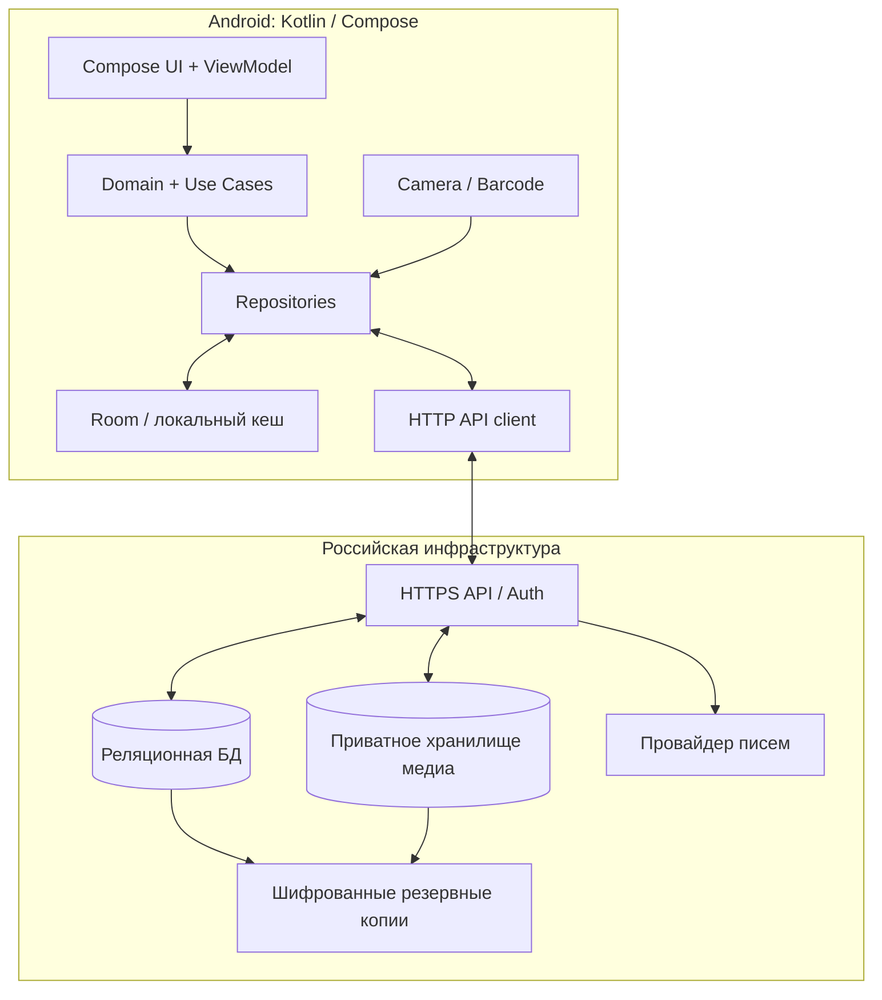

# KraPiva 2.0 — предварительная архитектурная схема

**Статус:** proposal/ADR input. Реальный backend язык, сервисы и версии НЕ выбирались владельцем и не должны выдаваться за утверждённые.

## 1. Клиент-серверное деление



**Важное ограничение:** API/БД/медиа/резервные копии/логи, где могут быть персональные данные граждан РФ, должны пройти проверку размещения и обработки в РФ. Диаграмма — логическая, не чертёж конкретного VPS.

## 2. Backend модули модульного монолита (предложение)

1. **identity** — email, пароль, verify, reset, sessions, adult confirmation.
2. **profile** — ник, био, avatar/cover, social links, privacy.
3. **catalog** — Breweries / BeerRelease / BeerPosition / BarcodeMapping / proposals / verification.
4. **checkins** — оценки, заметки, фото, места, idempotency, CRUD.
5. **social** — friends, feed, reactions, comments, privacy enforcement.
6. **stats-and-badges** — подсчёт total/unique и начальные 10 правил.
7. **venues** — реальные заведения, проверка, связь с чекинами, Yandex deep link.
8. **media** — upload/validation/storage/EXIF/ACL.
9. **moderation** — жалобы, admin rights, audit.
10. **operations** — health, migrations, backup, metrics, error reporting.

Это **границы бизнес-логики**, не требование создать 10 сервисов. Вначале один backend deployable с DB и object storage.

## 3. Принципы API

- HTTPS JSON, документированный OpenAPI, typed clients при подходящих средствах.
- Версионирование контракта и миграции; методы с повторной отправкой должны быть идемпотентны там, где возникает риск дублей (особенно checkins, media, wishlist).
- Пагинация; ограничение размера и частоты запросов; ETags/revisions или согласованная альтернатива.
- Сервер проверяет ownership, membership, visibility для **каждой** операции и каждого вложения.
- Response error schema с кодом, не выдающим персональные/секретные значения; client получает понятный UX.
- Новая позиция только после проверки становится подтверждённой; иной статус явно маркирован.
- Админ endpoints доступные только admin/moderator, с журналом действий.

## 4. Две архитектурные альтернативы для ADR

| Направление | Плюсы | Минусы/проверки |
|---|---|---|
| Kotlin backend (Ktor / Spring) + SQL | Общий язык с Android, строгая типизация | Сложность JVM runtime, потребность в памяти и сборке, версия библиотеки |
| Go/TypeScript backend + SQL | Независимый серверный pipeline и широкий выбор библиотек | Два языка/модели, потребуется дисциплина OpenAPI и контрактных тестов |

**Выбор не предрешён.** Codex должен обосновать ресурсные требования, доступность в своей среде, тестируемость, стоимость VPS, миграции, security/maintenance и время реализации; зафиксировать в ADR до большого объёма кода.

## 5. Уникальность позиции: решение на уровне домена и БД

**Обязательный инвариант:** `COUNT(DISTINCT checkins.position_id)` при условии `checkin.deleted_at IS NULL`, `checkin.user_id = requestedUser`. `position_id` — стабильная ссылка на `BeerPosition`. Опубликованная позиция имеет пивоварню, семейство/release и отличающие вариант признаки. При удалении/слиянии справочника сохраняются alias/redirect и история chekin.

**Пример:** позиция `P-1` = конкретная банка определённого выпуска ZAGOVOR, `P-2` = отдельный каталогизированный формат/выпуск. Чекины `P-1,P-1,P-2` → `total=3`, `unique=2`. Сорт как стиль IPA для уникальности не используется. На уровне API запретить считать уникальность отдельными barcode strings; отсутствующий GTIN не лишает позицию уникального `positionId`.

## 6. Offline & eventual consistency

- С самого начала UI разделяет **server-confirmed** и **locally staged**. Лента и чужие комментарии требуют сети.
- Для авторизованного пользователя разрешить read cached profile/catalog/diary; cache keys привязаны к `userId`, очищаются при logout/switch account.
- Опциональная очередь upload/checkin с idempotency keys и retries; без неё offline создание — честный черновик, не публичный пост.
- Любая смена privacy/delete должна инвалидировать публичные кэши/подписанные media URL по выбранной политике.
- Отсутствие облачной синхронизации не допускается в релизе 2.0; offline-cache — дополнительный уровень удобства.

## 7. Репозиторий и предлагаемые каталоги

```text
Kr2P1v2/
  README.md                   # сохранить/обновить
  AGENTS.md                   # сохранить, не менять без разрешения
  docs/
    TECHNICAL_SPECIFICATION.md
    PROJECT_DECISIONS.md
    architecture/
    decisions/
    api/openapi.yaml
    design/
    QA_TEST_PLAN.md
    RELEASE_READINESS.md
  android/                    # чистый проект Kotlin/Compose
  backend/                    # выбранный в ADR монолит + migrations/tests
  infra/                      # dev/staging шаблоны без секретов
  .github/workflows/          # CI Android/backend/schema/security
  tests/                      # cross-service E2E/contract
  .gitignore
  .env.example                # только имена переменных, не значения
```

Это **предлагаемая** файловая структура, не утверждённый технический стек и не указание выкладывать secrets.

## 8. Стратегия тестов и развёртывания

- Локальная проверка: backend + БД + хранилище + SMTP test relay (если выбраны), Android emulator, два тестовых аккаунта, тестовые записи/фото.
- CI: отдельные jobs lint/test/build, миграции, интеграция с тестовой БД, secret/license scanning, ABI/Android smoke при доступной среде.
- Staging в РФ при наличии предоставленного доступа; тестовый контент не смешивать с production.
- Production только после согласованного бюджета, домена, почты, ключей, юридической проверки и явного одобрения согласно `AGENTS.md`.
- Backup: архив БД и объектов + задокументированный и исполненный тест restore; не ограничиваться наличием скрипта.
