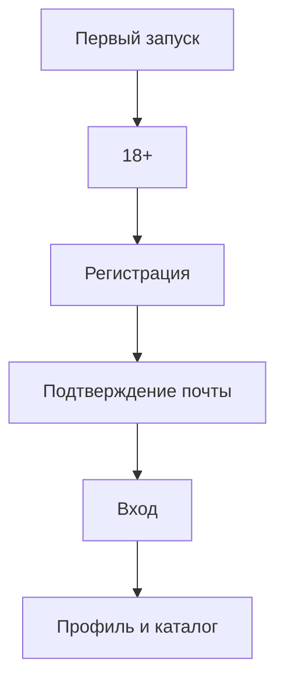
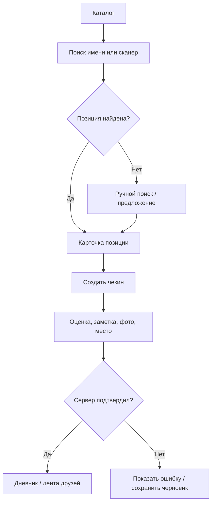
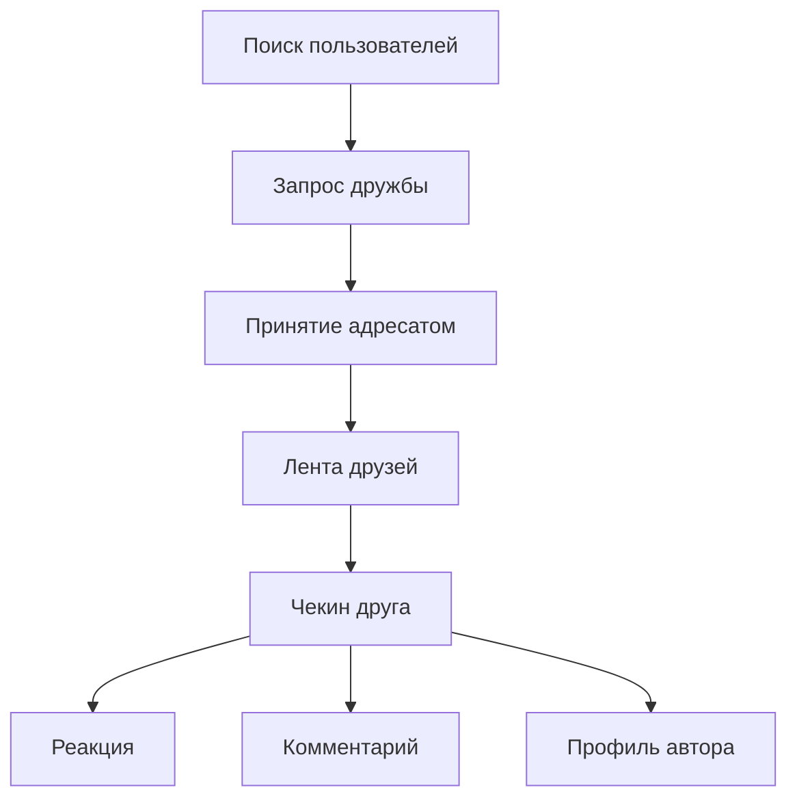

# KraPiva 2.0 — карта экранов и пользовательских маршрутов

Статус: часть целевого ТЗ; точная UI-композиция и нижняя навигация выбираются в UX ADR. Допускается переработка макетов, но не потеря функций.

## 1. Навигационные области

**Auth:** 18+ / регистрация / подтверждение почты / вход / сброс пароля.  
**Discover:** поиск по новым пивным позициям → карточка → чекин, wishlist, сканер, добавить позицию.  
**Social:** лента друзей → карточка чекина → реакция / комментарий → профиль автора; поиск людей → запрос дружбы → входящие заявки.  
**Diary:** список своих чекинов → карточка/редактирование/удаление; фильтры и счётчики.  
**Profile:** свой/чужой профиль → настройки и редактор / статистика / уникальные позиции / wishlist / значки / приватность / жалоба.  
**Places:** поиск реальных баров → карточка места → внешние Яндекс Карты → привязка к чекину.  
**Admin:** предложения пивных позиций, реальные бары, жалобы, аудит и права.

## 2. Два возможных варианта нижней навигации (на выбор UX ADR)

- **Вариант А (рекомендован как предложение):** «Лента», «Поиск», «+ Чекин», «Бары», «Профиль». Дневник и Wishlist доступны из профиля, кнопка создания чекина также в карточке позиции.
- **Вариант Б (ближе к старой версии):** «Каталог», «Дневник», «Лента», «Профиль». В профиле доступны Wishlist, значки и счётчики; «Бары» доступны через каталог/чекин.

Не выбирать навигацию молча без макета переходов. Сделать оба варианта недвусмысленно покрывающими весь список S-01…S-22 из главного ТЗ и зафиксировать выбор/причину в ADR.

## 3. Маршруты E2E

### Новый пользователь

### Поиск и чекин

### Социальная сеть

### Подсчёт уникальных позиций

`Checkin(userId, positionId)` → фильтр действующих записей → `totalCheckins = COUNT(checkins)` и `uniquePositions = COUNT(DISTINCT positionId)`; вся публичная статистика пользуется одной серверной логикой. Повторы допустимы. Разные подтверждённые варианты упаковок имеют разные `positionId`, поле подачи в момент чекина само по себе не порождает новый объект.

## 4. Состояния, проверяемые для каждого экрана

- Loading / empty / error / offline / недостаточно прав / действие завершено / действие ещё ожидает ответа.
- Доступность системной кнопки Back, восстановление из recent apps, переключение вкладок без потери заполненного поля.
- Для регистрации: неверная почта, неподтверждённая почта, устаревшая ссылка, reset/повторная отправка.
- Для контента: удалённое/скрытое/на модерации, неизвестное изображение, недоступный автор, нет друзей, нет каталожной позиции.
- Для камеры: доступ предоставлен/отказан, нет распознанного кода, неизвестный код, неправильная контрольная цифра.
- Для профиля: пустые коллекции, отсутствие аватара, отказ чтения фото, изменение публичности.

## 5. Доказательство работоспособности

Нужно не только наличие Composable/Activity, но и проверенный переход из реальной точки входа, чтение/запись через API, корректные состояния и возврат. К каждому экрану привязать FR, Route, ViewModel, Endpoint, Integration Test / Screenshot. Отчитаться о невыполненных переходах отдельно.
